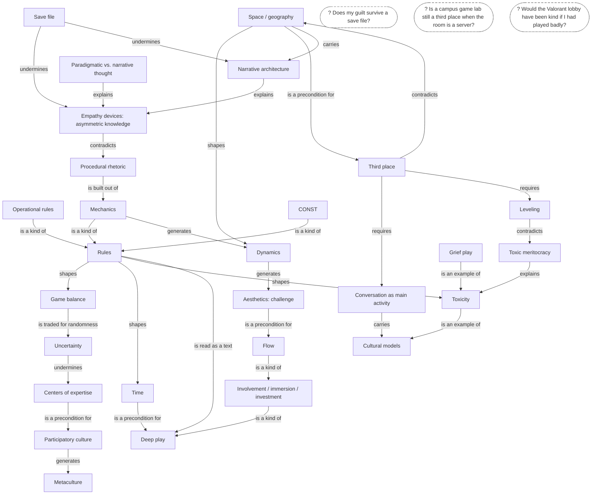

# Prompt

Understanding a topic means understanding not just its main concepts, but how those concepts relate to one another — how the material is conceptually organized. For your final homework assignment, construct a concept map of what you personally have learned from the course.

Your concept map should include:

At least 20 course concepts, represented as nodes.
Labeled lines or arrows connecting them, showing the nature of each relationship (causes, is an example of, contradicts, is a precondition for, is measured by, etc. — see this overview of relationship types for ideas).
At least 3 distinct types of relationship represented across the map — not just one relationship label repeated everywhere.
One “hub” concept that you identify as most central to your understanding of the course, with everything else connecting back to it, directly or indirectly. Write 2–3 sentences explaining why you chose it as the hub.
At least 2 “open question” nodes — marked with a question mark or dashed outline so they're visually distinct from concept nodes — representing something you're still puzzling over, or a topic you wish the course had covered but didn't. These don't need to connect to other nodes the way concepts do; just briefly note what the question is (as a caption on the map, or in your reflection paragraph below).
Finally, write a short paragraph (3–5 sentences) describing one connection that surprised you — something you didn't notice until you started building the map.

NOTE: No citations are required for the course concepts on this one. 

## Rubric

### Completion & Concept Grounding
Prompt fully answered; response connects clearly to at least one course concept in a way that shows real understanding, not just naming it.

### Personal Connections
Response is grounded in the student's own specific experience, choice, or reaction - something only they could have written.

### Nuance & Discernment
Genuinely weighs complexity — tension, ambiguity, competing considerations - rather than a flat, one-sided take.

# Answer

## Concept map

**Relationship types used:** is a kind of, is a precondition for, requires, generates, shapes, carries, is an example of, explains, contradicts, undermines.

**Hub: Rules.** Every assignment I wrote this quarter turned into the same test of the rules layer, which is the only thing that could reach Civ VI's yields, *Really Bad Chess*'s randomizer, *Valorant*'s five-player lobbies, and the save file I reloaded after killing Papyrus. When I put all of them on one page, the things I thought of as culture questions turned out to be rule questions. The lab is the exception that keeps the hub honest: its layout was a spatial rule, and the rule failed while the people made the place anyway.

**Open questions.**

- **? Does my guilt survive a save file?** I reloaded after Snowdin and got Sans back at his post, and I still do not know whether that was empathy or just me treating a loss as a failed puzzle.
- **? Is a campus game lab still a third place when the room is a server?** Steinkuehler and Williams make the online case, but I only ever checked the criteria in person.
- **? Would the Valorant lobby have been kind if I had played badly?** My one hour was uncontroversial output, so I cannot separate the welcome from the transaction.

The connection that surprised me was that constitutive rules and a save file are the same discovery. In *Really Bad Chess* I found the game's argument sitting one layer under the fiction, in the starting position, and in *Undertale* the thing that decided whether Papyrus's date meant anything was also a rule, the one that lets me reload. I had filed my chess homework and my Civ homework as formal analysis and my *Valorant* and VGDC homework as culture, and the map would not let them stay apart, because both come back to which layer is doing the persuading. What I did not expect was how much of the culture side is still rules: five players and thirteen rounds is why the cursing went at the AFK instead of at me, which makes toxicity partly a design output rather than a personality type. The lab is where the argument breaks, since every seat faced a screen and the third place happened anyway, and that one counter-example is why I trust the rest of the map.
