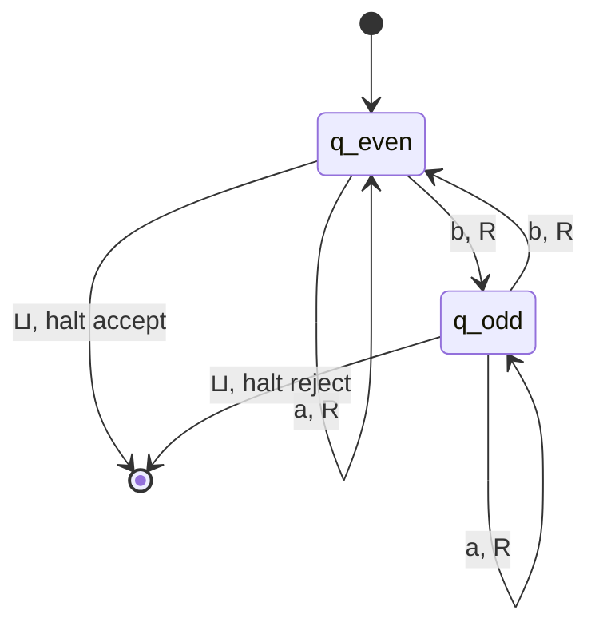

# 7.4.2
(a)
000

(b)
000

(c)
100

# 7.4.3 
(c)
The FSM accepts a string $x$ if and only if $x$ contains at least three consecutive $0$'s.

# 7.4.4 
(c)
![[Pasted image 20261121093847.png]]

# 7.5.1 
(c)
Accepts.
$aab\,q_3a \to aaba\,q_{acc}*$

(d)
Rejects.
$aab\,q_3b \to aabb\,q_{rej}*$

(e)
"bab" accepts: $ba\,q_4b \to bab\,q_{acc}*$
"bba" rejects: $bb\,q_4a \to bba\,q_{rej}*$

(f)
The machine runs right to the end of the input, then checks the last symbol against the first and accepts if and only if the string is nonempty and begins and ends with the same symbol. 

# 7.5.3 
(a)

# 7.6.1 
(c)
- Input: A list of items, each with a positive integer value and weight. Positive integers $W$ (weight limit) and $V$ (value target).
- Output: Yes if some subset of the items has total weight at most $W$ and total value at least $V$
