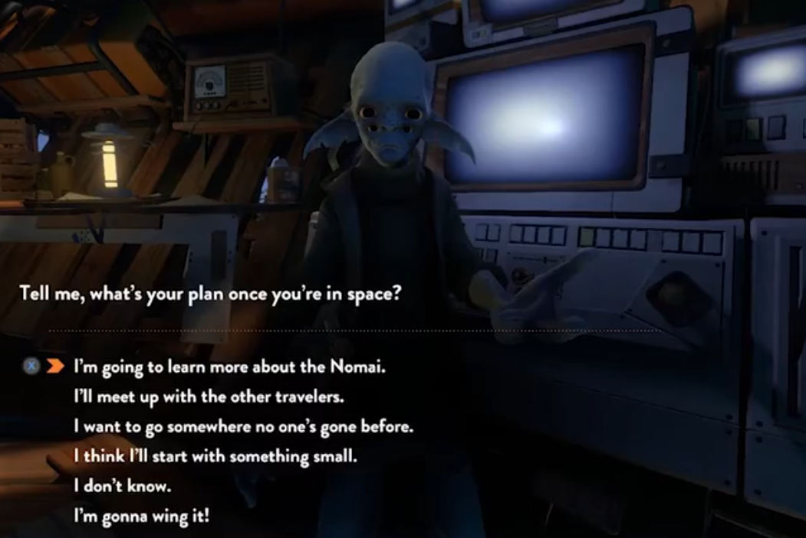
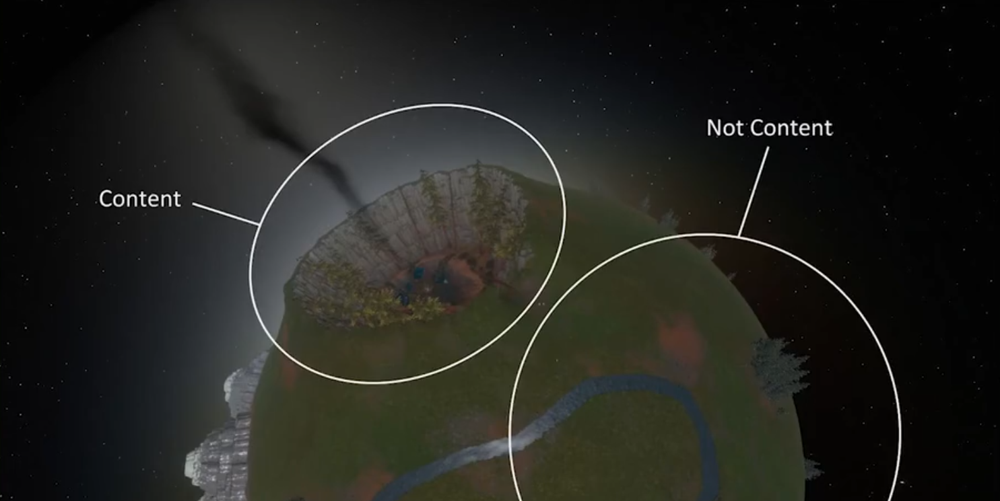
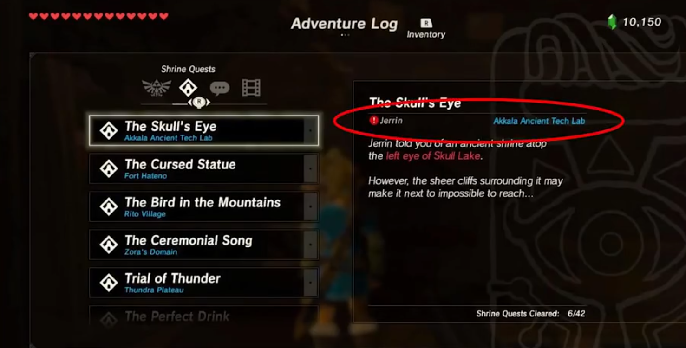

# 10 个让玩家**渴望探索**的奇怪技巧

## 1. 消除不必要的动机

不要让玩家为某种**具体的奖励**（金币等）而做事。
如果你的游戏本身形成了某种奇怪的正反馈，他们自然会到处跑！

## 2. 不要让玩家对所有事都感到好奇

换句话说：如果玩家对所有**小事**都感到好奇，他们就不可能对**内容**感到好奇。

你不能把玩家直接扔进一个全新的环境，然后放一大堆的墙 / 锁说"不不不，这才是你该走的路"。

所以，与[技巧 1](#1-消除不必要的动机)不谋而合，我们可以**减少兴趣点**，从
"你应该去看看坠毁的东西" 变成 "去太空吧！"
然后细无声地培养你的兴趣，比如**天文博物馆**，里面的兴趣点都指向太空。

另一种做法是不要让玩家对**特定的东西**感兴趣，而是让他们对一个概念 *in general* 感兴趣。

## 3. 没有目标会让很多人抓狂

所以让玩家**自己找到目标**对探索欲很重要。

与馆长对话时，他会问你"你准备在太空里干什么"：

从而迫使你思考你的目标。这不失为一种明确目标的好方法，比任务系统好多了！

## 4. 多做怪东西，多做爆炸

如果你把东西做得足够奇怪，玩家就会自然地好奇。

换句话说，把有内容的地方做得尽可能醒目，反之则不要，甚至粗糙都可以。

## 5. No Such Thing As "Just Lore"

想要让玩家保持探索，最好的方法是将每一次探索的反馈塞得满满的。

换句话说，不要在反馈中灌水！不要堆设定！不要炫耀你庞大的世界观（事实上世界观越小越好）！不要在墙角里塞一个愚人斗兽场！

如何确定一段剧情是不是灌水呢？看看它和你的[悬念](knowledge-locks.md)挂不挂钩。如果悬念只占文本中一半以下的内容，那是需要整改的。

## 6. 任务标记是**首恶**

任务标记可以有效将玩家沉浸在故事中而不要他们动脑子。
但是我们希望玩家动脑子，所以它已然成为了设计上的首恶。

野炊为了缓解其罪恶，将任务标记指向给你任务的人而不是要去的地点，不失为折中的手段。

## 7. 让故事 / 悬念与玩家体验切实相关

如果玩家成为剧情中的一部分，他们往往会更加专注。

并不是说让你玩老套的 Meta 把戏，而是当玩家感觉自己正在经历与文本中所读到的相同事件时，他们对文本会更注意，从而增强探索体验。

同时引出另一个重要的点：**不要把你的叙事放在几千年前的舞台上**。
因为很难解释为什么他们有直接与玩家体验相关的经历，所以不要折磨自己了。

## 8. 强调矛盾，定时炸弹和假身份

矛盾是经典的激发好奇心的办法。另一些好用的方法是假身份：很自然地会去想什么时候被揭穿。

## 9. 拒绝盲注

> 相关：<https://docs.google.com/document/d/1cqhgcc1wGtF-SkL2EpRkXnRzuvemXKk3nOwZkFUyiCc/edit?tab=t.0#heading=h.plmhyibkwzaz>

弱引导游戏常常摆了个十字路口，然后没了。玩家像无头苍蝇一般选一条路，期望能找到什么。

请不要让玩家盲注。立个告示牌，告诉他们你能得到什么，这样反而能提高他们的探索欲。

**让玩家带着问题探索。**

---

参见：[4.0 星际拓荒与带着问题探索](knowledge-locks.md)
