# 银河恶魔城设计 Tips 4.0：星际拓荒和带着问题探索

**出于对知识的渴望而去收集知识的行为，就是探索。**

引出两个问题：

1. 如何引出求知欲
2. 如何引导探索

## 案例解析

> 参考视频：<https://www.bilibili.com/video/BV1FzwreLEjh>

星际拓荒提出了 3 个核心**悬念**：

1. 挪麦人为何来？
   - 比宇宙更古老的信号：宇宙之眼
   - 解锁于飞船残骸 — 黑棘星
2. 挪麦人找到这玩意了吗？
   - 找到了，而且找到了宇宙之眼的具体坐标
   - 解锁于沉底模块 — 深巨星核心
3. 时间为啥在循环？
   - 沙漏双子计划，使用时间循环寻找宇宙之眼
   - 解锁于沙漏核心

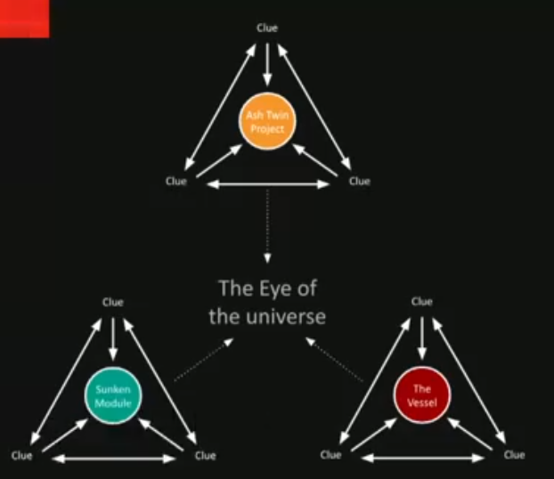

三个知识指向同一个终极知识：**宇宙之眼是什么？**
（其实这三个悬念也构成了这终极知识的锁钥结构。）

这三个悬念在游戏的早期阶段就被揭示，玩家可以选择一个感兴趣的悬念进行探索。
星际拓荒设计了 5 个大场景（双子、木炉、碎空、深巨、黑棘），并到处放各种线索使玩家能解答悬念。

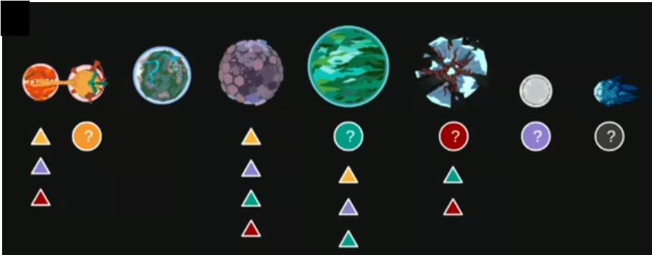

玩家拿到知识，前去应用这段知识，解锁新的知识，构成了基本的玩法。

更具体的分析"挪麦人为何来"这个悬念：

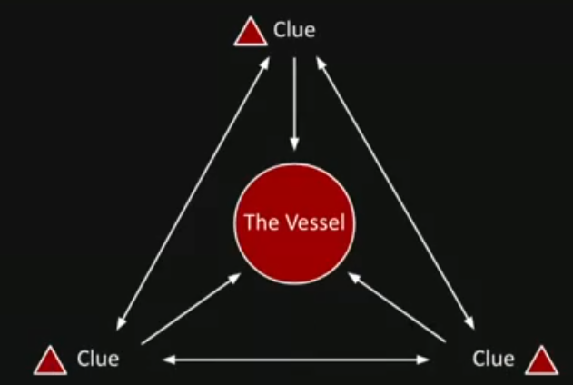

每个线索都与他们遇险时发射的三个救生舱中的一个相关联。
连接逃生舱线索的，是玩家通过**信号镜**接收到的求救信号：

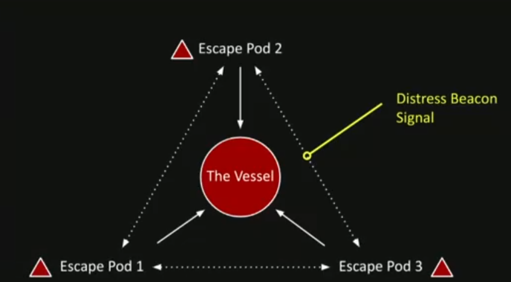

但是直接找到线索未免有些容易，只需简单让玩家跑一下图就能解决这个问题：

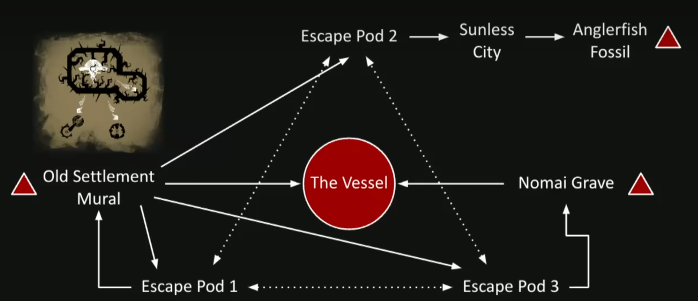

这本质上依然是原图，但是每个逃生舱都指向了其他的地方，再由这另外的地方指向悬念。
简单排列一下：

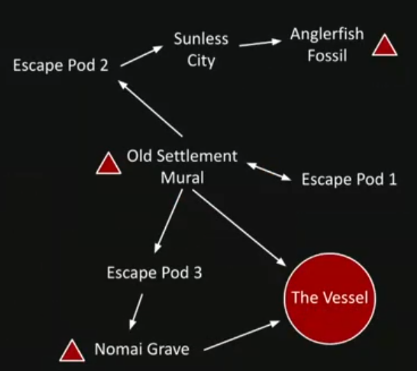

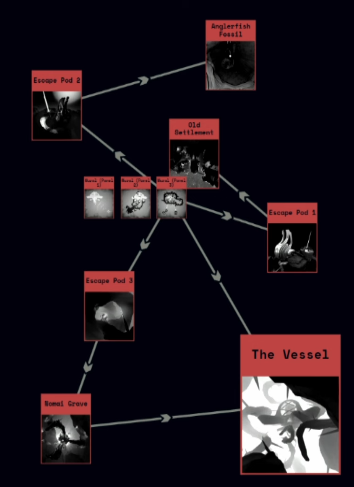

> 这样就成功设计了将近 ¼ 的星际拓荒！

然后设计一些玩家**能直接得到**的知识作为起点（村庄作为出生点）：

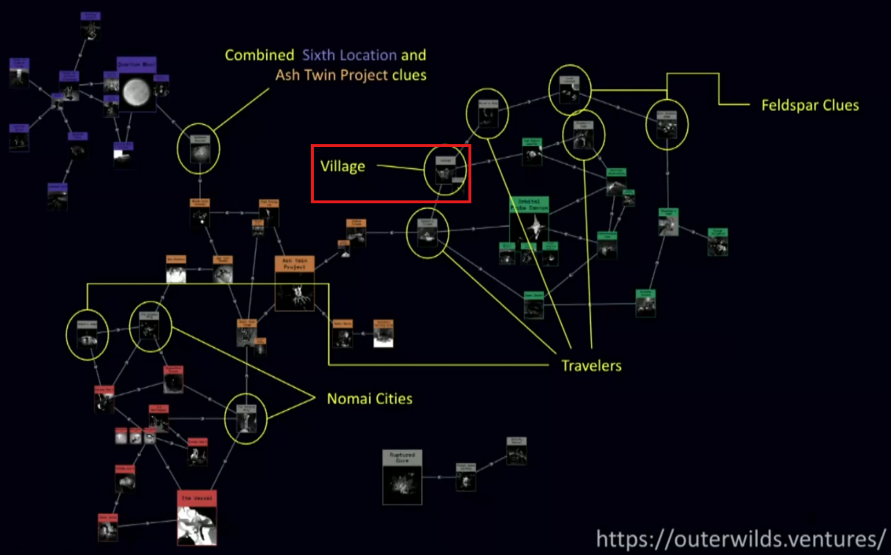

> 待补："眼的位置"谜题的图

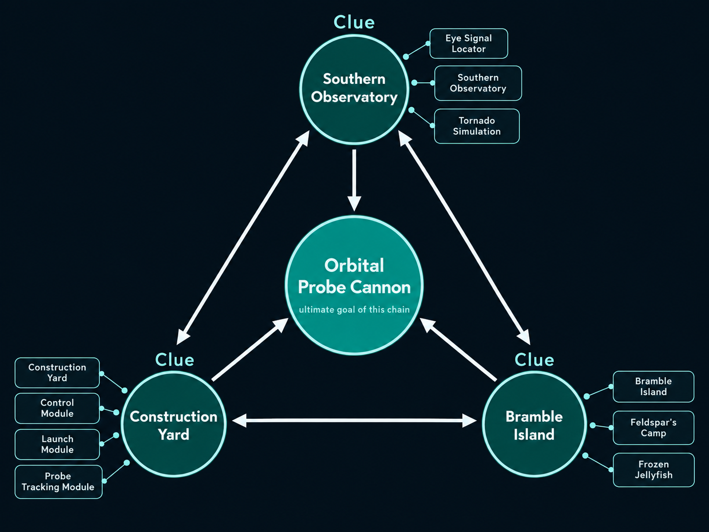

## 知识锁使用的基础方法：设计知识树

我们在设计开始时会给出 1–4 个核心知识，作为**悬念**。
这些知识都隐藏在地图中最难抵达的地方，作为一段故事的终点。

需要注意：

1. 悬念之间的**关系尽可能少**
2. 悬念之间**不能互相剧透**

现在，会在这个知识上上 2–4 个**锁**，锁钥结构可以是：

1. 另一个知识
2. 一些技能
3. 塞尔达的摇篮曲
4. Etc.

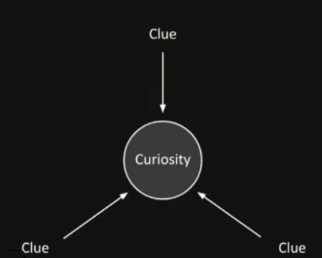

现在玩家要去寻找知识了。只需简单地把知识链接起来即可，这样玩家在得到知识后就知道该去哪了：

1. 水母尸体（知识）和深巨星核心（应用）
2. 成像法则（知识）和第六个位置（应用）

现在玩家开始到处跑了：

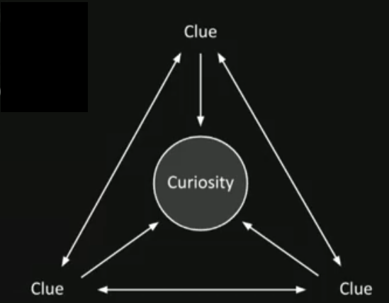

现在开始设计线索树，只需简单地把这三个起点线索拉长，加入很多**路程线索**即可：

路程线索就是用初始知识解锁的新知识，也就是用已有钥匙解锁的新钥匙。

解锁方法最好别用星际拓荒的纯跑图，来点有意思的玩法：

- Ori 的猛击
- Tunic 的打怪

当你有了足够庞大的线索树，开始设计大场景，并决定每个大场景需要给玩家什么线索。
星际拓荒设计了 5 个大场景（双子、木炉、碎空、深巨、黑棘），并到处放各种线索使玩家能解答悬念。

需要注意：

1. 请不要把所有关于一个悬念的线索全部塞进一个大场景
   - 这会形成一个舒适圈，并非常挫败探索
   - 尽量让玩家到处跑！
2. 不要让一个线索泄露另一条好奇链中的情节元素

> 我在开发一个设计软件，使你能够快速 Playtest 你的情节和锁钥结构，敬请期待！

之后就可以像传统银河城那样[设计大场景](map-design.md)了，再以[环式设计](loops.md)填充你的关卡，使每一次探索都做到真正的**好玩**。

毕竟说到底，游戏好玩才是探索的第一动力！不要让玩家关掉游戏后就找不到理由打开它了：探索可以锦上添花，但不能让游戏本身好玩。蔚蓝就是完美的例子——不需要探索，好玩本身就是真谛。

---

参见：[1.0 一般方法论](general-methodology.md) · [2.0 地图设计](map-design.md) · [3.0 回路设计](loops.md) · [10 个让玩家渴望探索的技巧](exploration-hooks.md)
