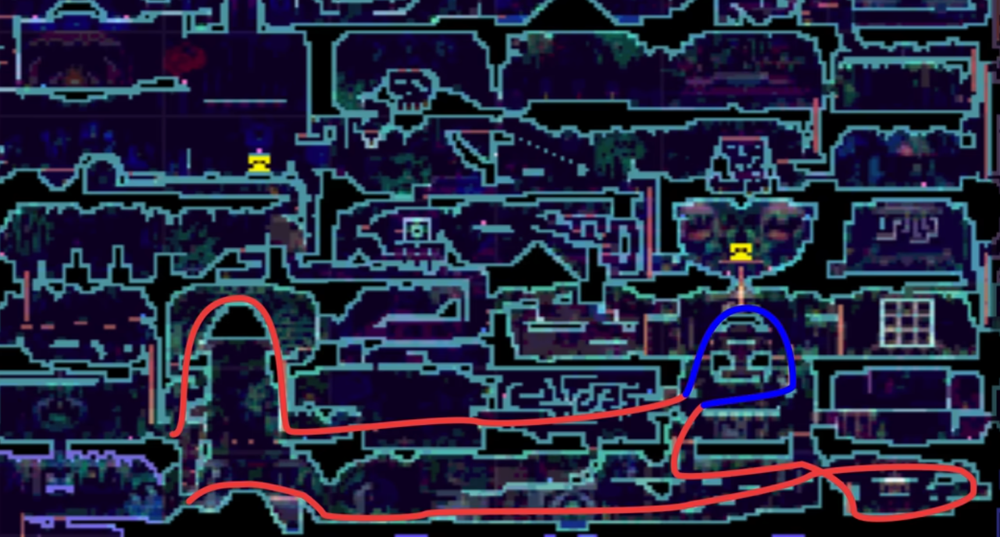
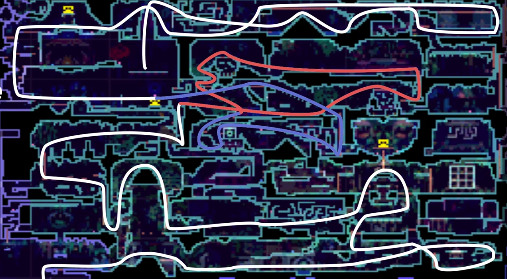
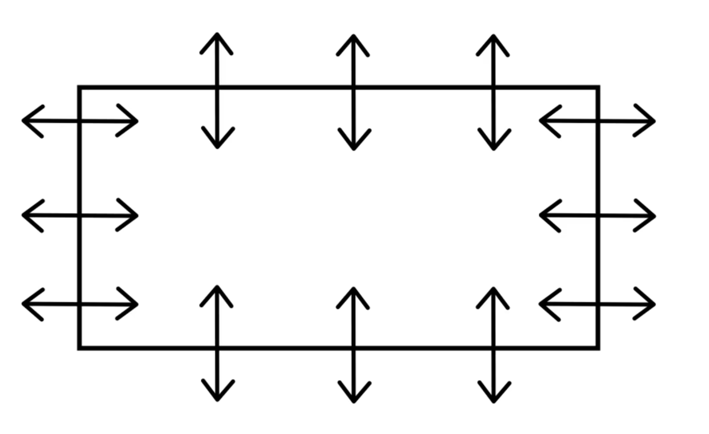
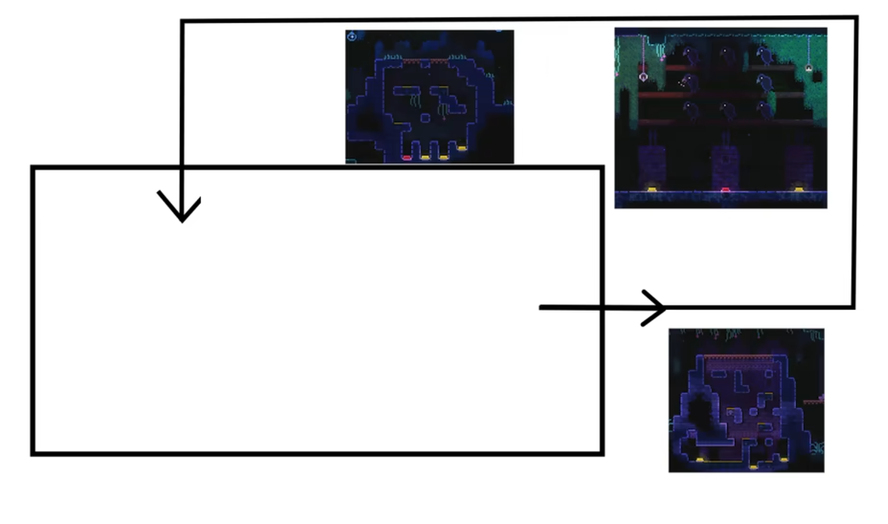
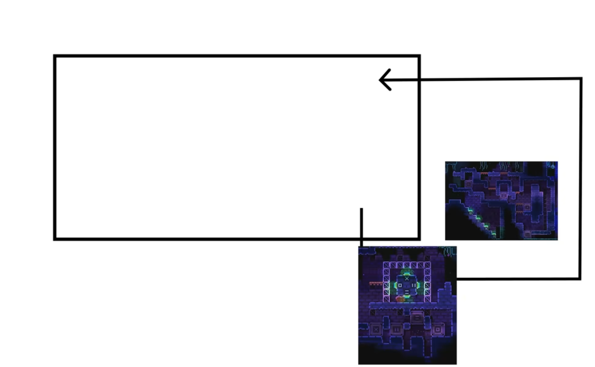
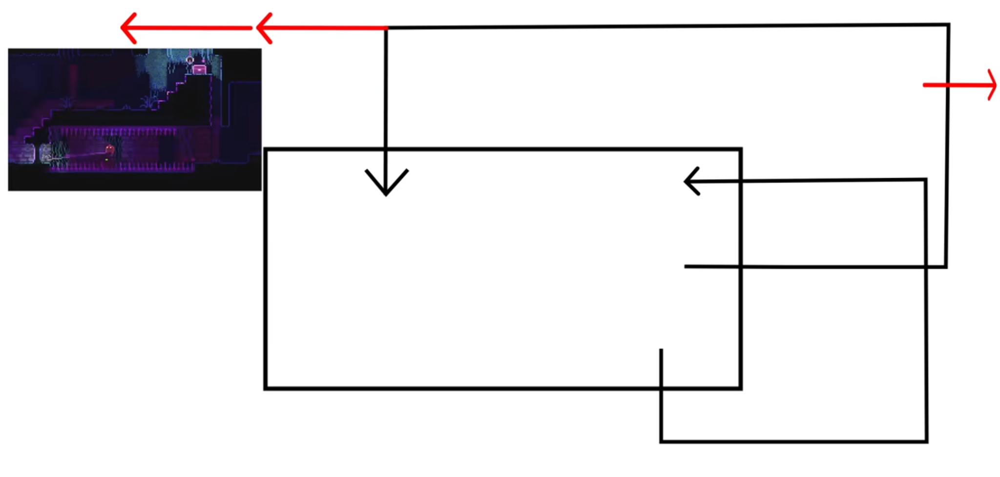
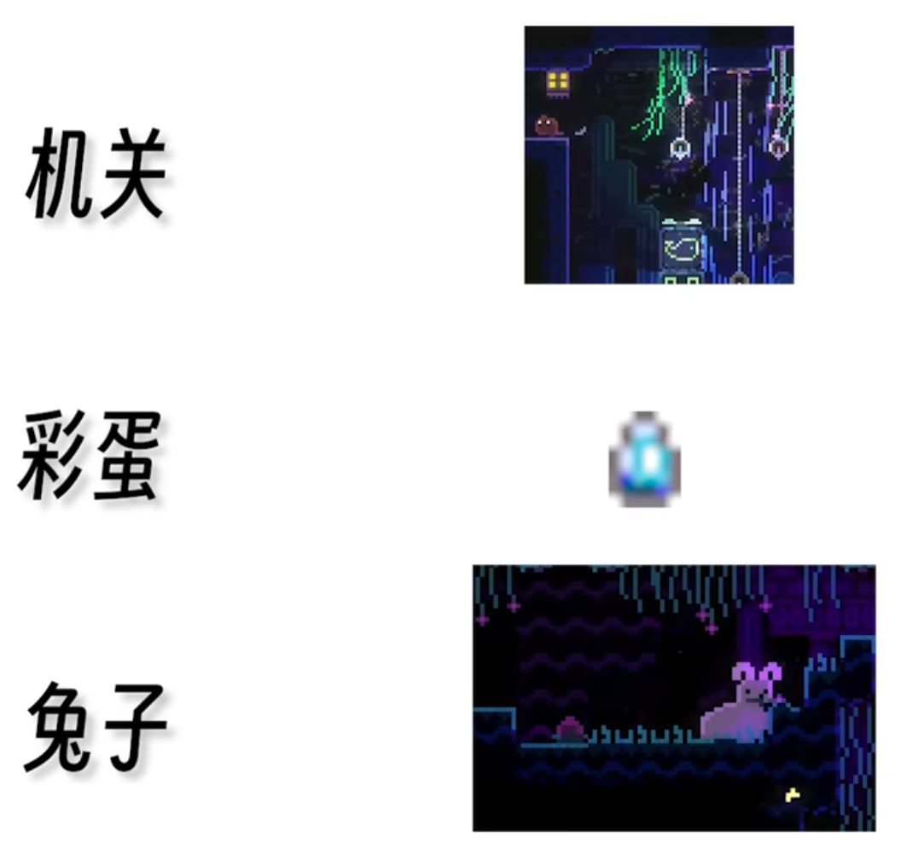

# 动物井和回路设计

基于**回路**进行地图设计，是银河城最核心的思路。

回路由于其性质非常适合银河城：

1. 有效控制探索自由度，进而影响心流
   - 自由度高，玩家对路线的熟悉程度低，心流情绪偏高
   - 反之，自由度低，心流情绪低
2. 在回路结束时回到熟悉区域，进而给予极强的正反馈
3. 回路可以通过**单向锁**轻松做到线性地图无法做到的拓展感
4. 回路可以添加大量的嵌套和支线，实现非线性感

## 案例解析

> 参考视频：<https://www.bilibili.com/video/BV1gVy8YQEiy?t=99.6>

第一个回路：红圈为主线

1. 在中间添加大量的小回路作为支线 → 提升心流
2. 在结尾端回归线性 → 放缓心流

同时，在红圈结尾放置较难谜题，并获取新道具**妙妙圈**：

1. 在短时间内将已经归于平缓的心流再次推高
2. 在推高后让玩家回到起点，迅速降低

> 可见多巴胺**不是**心流体验与玩家技能相继走高，而是**快速**增长和走低的过程。

红蓝回路是对新获得的技能妙妙圈的 **IPMT**（起承转合式教学）：

1. 红圈完成"起"和"承"
2. 蓝圈完成"转"

两个圈充斥着异常精巧的谜题设计。

## 回路使用的基础方法

选取一个版面作为回路起点：

进行回路并回到起点（可以在回复处设置单向锁）：

同时可以开始新的回路，**根据玩家心流**自由调整：

为什么将回路塞在一起？

- 因为重复的起点可以作为有效走低心流的手段
- 因为重复的起点可以作为成就感和探索感的来源
- 可以重复的起点可以作为中枢 / 游戏村
  （参考空洞骑士的十字路，本身即是回路，又连接所有其他的回路）

> 好处多多，日后自有体会。

## 嵌套回路和非线性感

大回路的编排在前期缺少技能时是较为线性的。如何增加非线性感？
嵌套回路的性质非常适合提供这个感觉：

1. 主线之外，没有任何通过的必要
   - 纯粹由好奇心驱使
   - 提供大量的探索感
2. 支线之间可以互相联系，如同单元剧一般独立而相连
   - 一般通过**锁钥结构**相连，如能力、剧情、消耗品等
   - 联系产生的正反馈多种多样，就看设计能力了

**通过支线之间的锁钥结构，递归制造非线性感。**

编排方法：

如图，嵌套支线直接由主线衍生出，一般放置于需要提升心流处。

若想进一步提升正反馈，可对支线进行区分：

如图，机关是主线，彩蛋是支线奖励，兔子是挑战奖励，清晰明确。

## 非线性流程和不确定能力的问题

如何解决非线性流程中不确定玩家解锁了哪些技能的问题？

答案是设计一些**多变的能力**：一个能力拥有更多的能力（Dynamic），使一些谜题可以用不同能力解开。

---

参见：[1.0 一般方法论](general-methodology.md) · [2.0 地图设计](map-design.md) · [4.0 知识锁](knowledge-locks.md)
