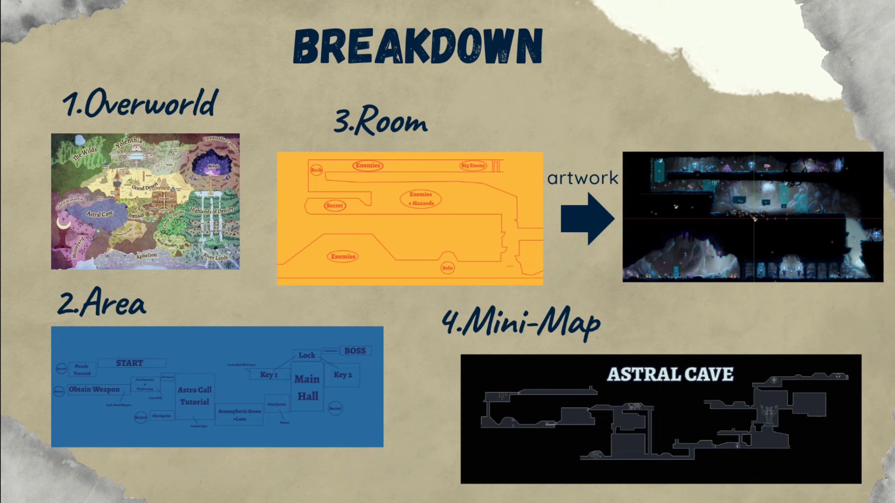
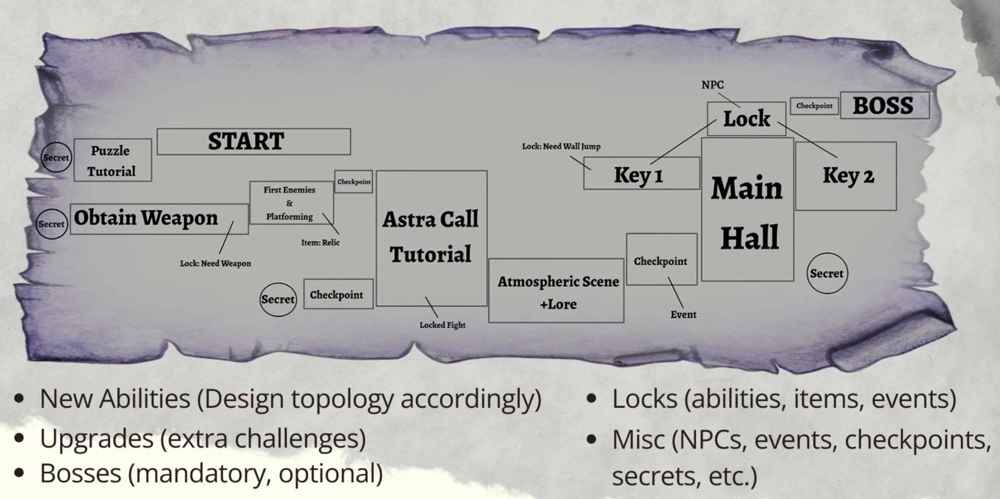

# 银河恶魔城设计 Tips 2.0：由大至小，由面概点

## Map design

从大至小，由全概面：

1. 关键点、目的地
2. 主要路线、地标、关键能力
3. 故事板、事件
4. 景观
5. Lore

## 机制和起承转合

1. 在起承转合的任意阶段都要**有意识地**为关卡留出空间，为未来可能的岔路做好准备
   - 也要注意放置奖励和额外挑战
2. 对于一个机制，你可以做一些小型的关卡 brainstorm
   - 试着用平时攒着的想法来尽可能高效地做一些关卡的设计
   - 归纳一下其中的元素，即机制的 **Dynamic**，再对它们进行重组和整合，以此来创造充分利用各项元素特质的优秀关卡
3. 对于一个机制，反复利用、重复利用、组合利用，创造新的"承"和"合"

---

参见：[1.0 一般方法论](general-methodology.md) · [3.0 回路设计](loops.md) · [4.0 知识锁](knowledge-locks.md)
