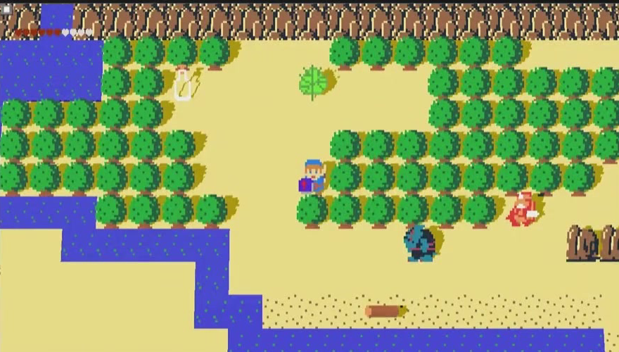
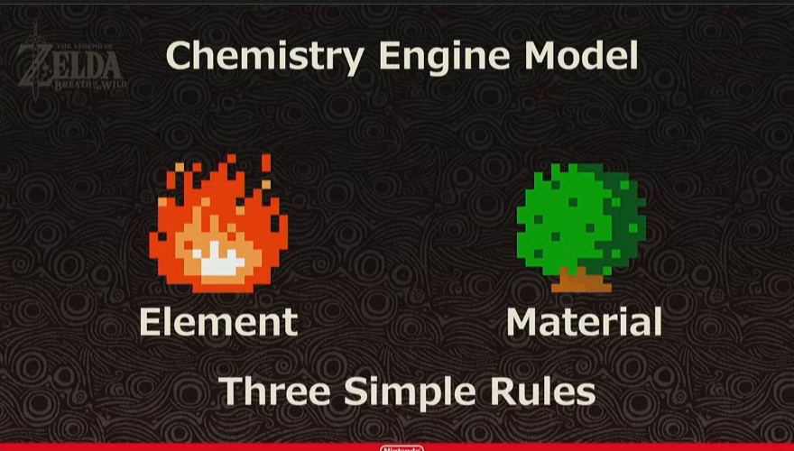

# 打破惯例的复合玩法：荒野之息 GDC 2017

## 设计：从"被动游戏"到"主动游戏"

出发点是两句话：重新发现系列的精华（Rediscovering the essence）、打破常规（Breaking Conventions）。

> [!系列的精华]
> **初代塞尔达**的设计理念其实非常高明：宫本茂想要一款与《超级马里奥兄弟》做出区别的游戏，一个非线性的（锁钥），以构建世界性（探索）为驱动的游戏。在时代和科技的限制下，它没有发挥全部的潜力。
> 
> 但其精华，探索与知识锁，与如今的设计理念不谋而合。
> 
> ![[Pasted image 20261122171613.png]]
> *NES 塞尔达的地图。玩家在几乎每一个房间都可以向任意方向探索。*

藤林想做的是"玩家自己决定去哪、做什么"的游戏。初代塞尔达每次进入新房间都有**新发现**和**新解法**（新的**知识**和**知识锁**），那就是他要的体验。

要做出这样的游戏，得先拆掉四条系列惯例：

1. 玩家必须按既定顺序推进
2. 制作者出于关卡需要，设置了"翻不过去的墙"
3. 玩家没走过预设的体验，难度和提示就不合适
4. 地牢谜题的答案在网上一查就有

### 攀爬
把"墙"变成"可以攀爬的面"。
![[Pasted image 20261122172442.png]]

边界于是成了另一条可选的路。
![[Pasted image 20261122172232.png]]
> 所有的“障碍”都不过是不同的路径了。遇到高墙既可以选择翻越，又可以选择绕过。

### 滑翔
爬上高处，自然的，你跳。
![[Pasted image 20261122172515.png]]
> 一旦你爬上去，你就可以飞到任何你想去的地方

### 复合玩法
动作和地图互相复合，这套做法就叫复合玩法（Multiplicative Gameplay）。

传统塞尔达的谜题物体是专门为谜题做的，打磨精细但成本高。旷野之息则给出一组情况加一个目标。

他用一张 2D 原型验证这套思路（所以林克是蓝衣服）。原型里一个谜题都没有，只有树和河，玩家却会自己动脑子找出一条路。

> 只给出情况与目标；玩家采取不同的行动时，**道具**、**物体**和**场景**各自反应，并复合在一起。

这就是知识锁：风景在获得知识后则会变得截然不同。一个例子：
> [!知识锁一则]
![[Pasted image 20261122172828.png]]
> 这种复合玩法可以在风景和目标之间中找到。
> 
![[Pasted image 20261122173000.png]]
> 如果你能看到世界上元素之间的这些联系，周围的风景则会获得新的意义并向你提出问题。
> 它也应该激励你去实验和尝试各种新奇的想法，并**总是回应**。
> 
> 换句话说，知识锁在玩家意识到它是锁时就解开了。*人猿仰望星空就像发现宝石，人类的历史不过是将宝石拾起罢了*。

## 技术：物理引擎与化学引擎

堂田把动作游戏拆成三块：碰撞、运动、状态。前两者是物理，第三者是化学。

游戏物理不是真实物理，而是"谎言"：为了可操控性、反馈和性能，必须撒谎。但谎言要有依据，玩家在现实中见过的现象，能让他在游戏里信任这套规则。（虽然物理模拟最终交给 Havok。）

几个具体的“谎言”：

- **Stasis**：不是让物体静止，而是给它一个反向的力顶住，时间恢复时撤掉即可
- **Magnesis**：不是磁力，只是"看起来像磁力"，换来稳定与自由控制
- **攀爬**：林克与被攀爬面之间的动态约束，因此能爬会动的物体
- **砍树**：树不是"被破坏"，而是变成了一个"被伐下的物体"；木头浮在水上也是假的浮力

物理引擎是基于规则的运动计算器，化学引擎是基于规则的状态计算器。模型里只有两类东西和三条规则：

1. 元素可以改变材料的状态（火烧掉树上的叶子）
2. 元素可以改变另一个元素的状态（水浇灭火）
3. 材料之间互不影响（树碰到树，什么都不发生）

电和风在教科书里不算化学，但这里也算元素。这个系统细究和化学一点关系都没有，不过是一个状态计算器。

### 复合，而不是叠加

> 过往的塞尔达把游戏元素 1+1 地**叠加**在一起，荒野之息让它们**相乘**。

一块金属板的本意是帮玩家过河，但玩家可能想把它砸在敌人身上，想跳上顺流而下的木头，或者想爬上被 Stasis 定住的物体。世界里每个角落都塞满了"情况与目标"。开发组有自己预设的解法，但希望玩家自己想出解法，目标是那声"我的天哪，我真是个天才"。