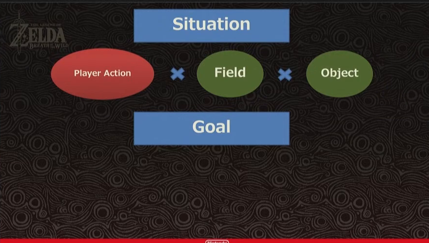
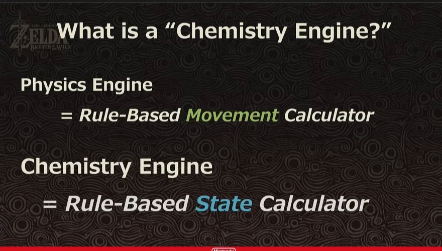

# 打破惯例的复合玩法：荒野之息 GDC 2017

## 设计：从"被动游戏"到"主动游戏"

出发点是两句话：重新发现系列的精华（Rediscovering the essence）、打破常规（Breaking Conventions）。

> [!系列的精华]
> **初代塞尔达**的设计理念其实非常高明：宫本茂想要一款与《超级马里奥兄弟》做出区别的游戏，一个非线性的（锁钥），以构建世界性（探索）为驱动的游戏。在时代和科技的限制下，它没有发挥全部的潜力。
> 
> 但其精华，探索与知识锁，与如今的设计理念不谋而合。
> 
> ![[Pasted image 20261122171613.png]]
> *NES 塞尔达的地图。玩家在几乎每一个房间都可以向任意方向探索。*

藤林想做的是"玩家自己决定去哪、做什么"的游戏。初代塞尔达每次进入新房间都有**新发现**和**新解法**（新的**知识**和**知识锁**），那就是他要的体验。

要做出这样的游戏，得先拆掉四条系列惯例：

1. 玩家必须按既定顺序推进
2. 制作者出于关卡需要，设置了"翻不过去的墙"
3. 玩家没走过预设的体验，难度和提示就不合适
4. 地牢谜题的答案在网上一查就有

### 攀爬
把"墙"变成"可以攀爬的面"。
![[Pasted image 20261122172442.png]]

边界于是成了另一条可选的路。
![[Pasted image 20261122172232.png]]
> 所有的“障碍”都不过是不同的路径了。遇到高墙既可以选择翻越，又可以选择绕过。

### 滑翔
爬上高处，自然的，你跳。
![[Pasted image 20261122172515.png]]
> 一旦你爬上去，你就可以飞到任何你想去的地方

### 复合玩法
动作和地图互相复合，这套做法就叫复合玩法（Multiplicative Gameplay）。

传统塞尔达的谜题物体是专门为谜题做的，打磨精细但成本高。旷野之息则给出一组情况加一个目标。

他用一张 2D 原型验证这套思路（所以林克是蓝衣服）。原型里一个谜题都没有，只有树和河，玩家却会自己动脑子找出一条路。

> 只给出情况与目标；玩家采取不同的行动时，**道具**、**物体**和**场景**各自反应，并复合在一起。

这就是知识锁：风景在获得知识后则会变得截然不同。一个例子：
> [!知识锁一则]
![[Pasted image 20261122172828.png]]
> 这种复合玩法可以在风景和目标之间中找到。
> 
![[Pasted image 20261122173000.png]]
> 如果你能看到世界上元素之间的这些联系，周围的风景则会获得新的意义并向你提出问题。
> 它也应该激励你去实验和尝试各种新奇的想法，并**总是回应**。
> 
> 换句话说，知识锁在玩家意识到它是锁时就解开了。*人猿仰望星空就像发现宝石，人类的历史不过是将宝石拾起罢了*。

## 技术：物理引擎与化学引擎

堂田把动作游戏拆成三块：碰撞、运动、状态。前两者是物理，第三者是化学。

游戏物理不是真实物理，而是"谎言"：为了可操控性、反馈和性能，必须撒谎。但谎言要有依据，玩家在现实中见过的现象，能让他在游戏里信任这套规则。（虽然物理模拟最终交给 Havok。）

几个具体的“谎言”：

- **Stasis**：不是让物体静止，而是给它一个反向的力顶住，时间恢复时撤掉即可
- **Magnesis**：不是磁力，只是"看起来像磁力"，换来稳定与自由控制
- **攀爬**：林克与被攀爬面之间的动态约束，因此能爬会动的物体
- **砍树**：树不是"被破坏"，而是变成了一个"被伐下的物体"；木头浮在水上也是假的浮力

物理引擎是基于规则的运动计算器，化学引擎是基于规则的状态计算器。模型里只有两类东西和三条规则：

1. 元素可以改变材料的状态（火烧掉树上的叶子）
2. 元素可以改变另一个元素的状态（水浇灭火）
3. 材料之间互不影响（树碰到树，什么都不发生）

电和风在教科书里不算化学，但这里也算元素。这个系统细究和化学一点关系都没有，不过是一个状态计算器。

### 复合，而不是叠加

> 过往的塞尔达把游戏元素 1+1 地**叠加**在一起，荒野之息让它们**相乘**。

一块金属板的本意是帮玩家过河，但玩家可能想把它砸在敌人身上，想跳上顺流而下的木头，或者想爬上被 Stasis 定住的物体。世界里每个角落都塞满了"情况与目标"。开发组有自己预设的解法，但希望玩家自己想出解法，目标是那声"我的天哪，我真是个天才"。

## 关卡区域设计

### 测玩热力图

最开始的野炊是由15塔构成的。玩家在漫无目的的游荡，天然会被塔吸引，所以在塔之间放置玩法互动就可以了对吧！

于是有了几百人测玩后的路径染色图。只被一个人走过的区域是黑色，走得多的区域更亮。结果它证明了最开始的这个想法**一败涂地**。
![[Pasted image 20261122181741.png]]
> 几乎所有人都是沿着道路走的。没有任何探索。那些“勇于探索”的少数玩家，则几乎错过了所有的神庙，塔和谜题。

设计团队急切的需要：
1. 引导玩家的方法
2. 基于场景的引导
3. 区域设计图的制作手法

### 引导玩家的方法

最初的引导是**点和线**：塔是"点"，塔与塔之间摆事件。测玩结果两极分化：一批人顺着路走，一批人叛逆地绕开事件。反馈也两极：*"不喜欢只有一条路的设计"*、*"走半天没触发事件太无聊了"*。

![[Pasted image 20261122182626.png]]

引导成功了，但**刻意感**藏不住。于是换成"引力"。

> [!引力]
> ![[Pasted image 20261122182651.png]]
> 被光源吸引的昆虫。游戏里对应的光源，是**有正向收益的地方**。

改良的做法：

加强：
1. **马厩** 加强：原本只是登记马的功能点，加上驿站属性，变成能从 NPC 换情报的地方
2. **祠堂** 发光：本来就有引力，改外观让它在白天更显眼
3. **敌人的基地** 加强：放有用的武器
4. **路边** 丰富：有奇怪花纹的岩石，勾出"那是什么？"

削弱：
1. 武器只能从敌人和宝箱拿
2. 卢比极其稀有
3. 料理材料只限植物和野生动物掉落

**所以野外一个蘑菇也变得明确价值。** 蘑菇可以换钱，补血，炼药等等。这样，即便是随处可见的森林，都有了“引力”。
武器和蘑菇从远处都看不见，但玩家一旦养成习惯（"林子里应该有蘑菇"），就会自己跑过去——这些就是不可见的引导线。

问题是引力会互相打架：玩家被蘑菇吸住，别处的引力就变弱了。解法是**分层**：

![[Pasted image 20261122182736.png]]

1. 在塔上放看得见的引力地标
2. 在去那里的路上再塞别的引力单位
3. 引力互相连锁，形成"永动引力机关"

在塔上看见祠堂、滑翔过去、半路发现别的想去的地方——这条链条就是设计出来的。

引力的强弱还分几种：
1. 体积越大越显眼引力越强
![[Pasted image 20261122182837.png]]

2. 目标是变强的玩家眼里祠堂引力最大；
![[Pasted image 20261122182846.png]]

3. 夜里发光物更显眼。
![[Pasted image 20261122182859.png]]

**引力是动态平衡的。**

### 二、场景引导：三角形法则

"海拉鲁是记号的集合体"，基础形状是三角形，一个三角形干三件事：

1. **分流**：山丘山峰都是三角，爬山时可以直着上，也可以左右迂回
![[Pasted image 20261122172232.png]]

2. **渐次遮蔽**：迂回时，山后的塔从岩壁后面一点点露出来；直着上则从山顶慢慢看见。"**渐渐**"是关键——"在前往目的地的途中，视线的前端自然地转移到另一个目的地上"
![[Pasted image 20261122183142.png]]

3. **视线引导到顶**：人会不由自主看三角的顶端，所以奖励放那里；反过来也可以故意放在外面
![[Pasted image 20261122183137.png]]

按大小分工：大三角当路标（大型引导线），中三角藏路线和场景，小三角促进指令输入、丰富体验。
![[Pasted image 20261122183211.png]]

三角形之外还有变形：

- **四边形**：敌人在四边形场景后面冒出来，道具埋在林深处 → 意外
![[Pasted image 20261122183237.png]]
> 矩形石头后面会有东西？

![[Pasted image 20261122183316.png]]
> 是怪物？是蘑菇？是药材？是宝箱？
- **梯形**：上方是平台，既遮信息又引视线，让人想"上面好像有东西，去看看"
![[Pasted image 20261122183358.png]]

地图不是自动生成的。**做完走一遍，改完再走一遍**，反复打磨。演讲里放了两版录像：

- 改前：林克朝远处的塔直走，一路没有遮蔽，塔一直在视野里。看着无聊。组员的意见：前面加一堵峭壁挡住视线；想办法增加玩家推摇杆左右和转视角的次数
- 改后：深处风景藏在岩壁后面 → 走着走着出现建筑 → 建筑后面露出塔 → 近景摆上马车（"马车旁边可能有道具"）。遮蔽与开阔轮流出现，玩家就不由自主开始绕远路

呀哈哈同理：为了让人有"探索、游玩"的满足感，会增加需要输入的指令（转镜头、跳），并把探索路线按三角形摆好。音效也在这条线上——草地、土地、骨头上踩下去的声音都不同，地面材质有明确区分。

总之是**动作全覆盖**：有频繁跳跃的区域，有主要用左右肩键的区域，有骑马悠闲逛的区域，按体验的多样性来设计。

### 三、区域设计图：三个维度

藤林回到最基础的"区域设计图"，只看三个指标：**距离感、密集感、尺度感**。做法都是一样的：**找一个现实里能感知的东西，然后把它数值化。**

**距离感（长度、广度）**
用京都当参考。京都出身的藤林说，熟悉的街道做起来更有感觉：从京都御所望向京都塔能看到多远？拿实地量距离感。然后先做一块按测量尺寸还原的区域，往里摆脑海里的玩法场景，验证。

**密集感（间隔）**
引力单位该隔多远摆一个？有现实密度可参考就直接抄：便利店的分布密度、邮箱的分布密度。定下密度单位，调查分布，数值化。*"密度的参考，在街道上到处都是。"*
旷野之息里构成这个密度的是 **120 个祠堂**（准确说是 116 个，最终调整到 120）。和初期设定相比基本没大改。

**尺度感（时间、节奏）**
玩家花多少时间才觉得舒服？按时长倒推：大型地牢 **40 分钟**，小型地牢 **5–20 分钟**，主线任务 **100 分钟**（都是开发阶段的参考值）。
这场演讲 1 小时，正好等于一个大型地牢。
